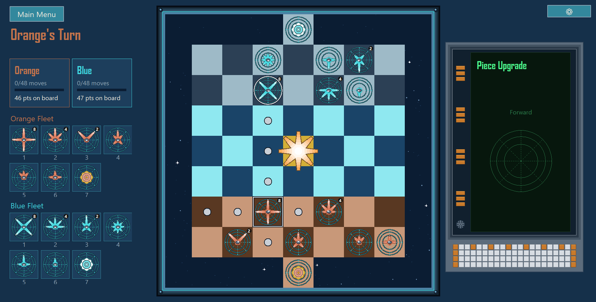
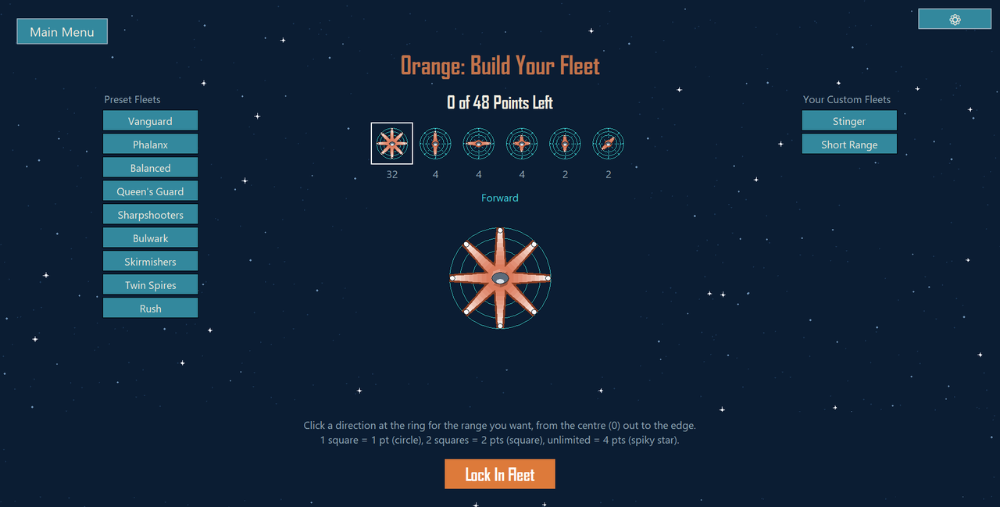
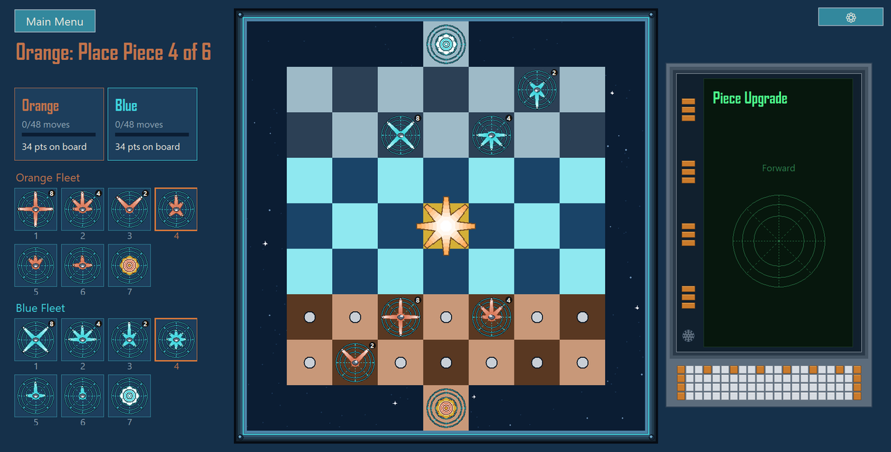
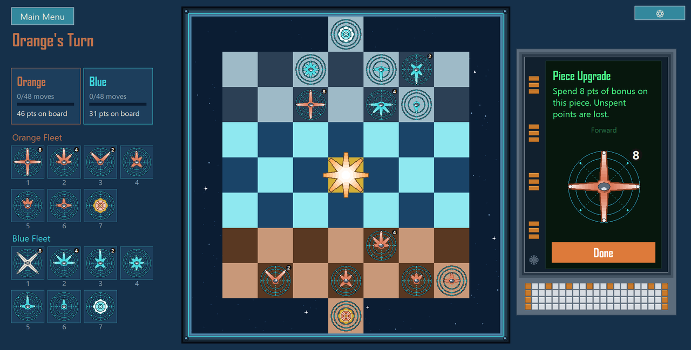
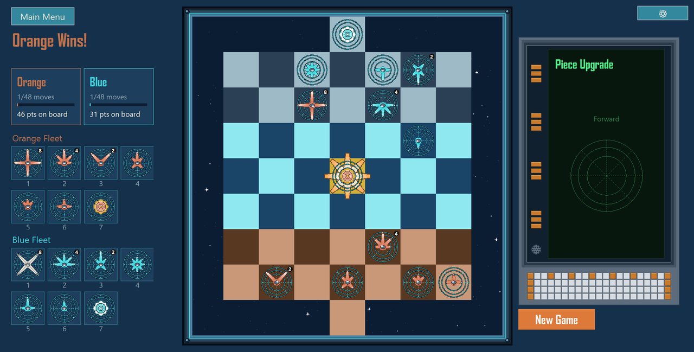

# Spokebound

A chess-style strategy game for two players in which you design your own
pieces, written in Python using only the standard library. A personal
project covering game-playing AI, evolutionary optimisation, peer-to-peer
networking and desktop UI engineering, with an automated test suite and
a packaged Windows build.

Development began in July 2026, and the project moved to GitHub in
November 2026, which is why the commit history starts there.


[](https://github.com/Git4AlexD/spokebound-chess-ai/actions/workflows/ci.yml)




## Contents

- [Overview](#overview)
- [Technical highlights](#technical-highlights)
- [Design decisions](#design-decisions)
- [Running the project](#running-the-project)
- [Project structure](#project-structure)
- [Limitations and next steps](#limitations-and-next-steps)
- [Credits](#credits)

## Overview

Each player spends a fixed points budget building six pieces. A piece is
defined by eight *spokes*, one per compass direction, and each spoke's
range is set to none, one square, two squares or unlimited, at increasing
cost. Players then place their pieces in their own back rows and play on a
7×7 board under chess-like rules, including check. A move that captures a
high-value piece or reaches the far row earns bonus points, spent
immediately on upgrading the piece that moved. A game is won by moving
your Captain onto the centre square, by checkmate, by leaving the opponent
with no legal move, or on points when the move limit runs out.

The application supports local two-player games, games against a
computer opponent with ten difficulty levels, and online games between two
machines. The full rules are on the in-game Instructions screen.

| Fleet builder | Deployment |
| :---: | :---: |
|  |  |
| **Upgrade after a capture** | **End of a game** |
|  |  |

## Technical highlights

### Game-playing AI ([`spokebound/ai/`](spokebound/ai))

- An **iterative-deepening alpha-beta search** with a time budget per move
  ([`search.py`](spokebound/ai/search.py)), using quiescence search, a
  transposition table, aspiration windows, principal variation search,
  late-move reductions, check extensions, static exchange evaluation
  ([`exchange.py`](spokebound/ai/exchange.py)), and futility and history
  pruning.
- **Ten difficulty levels defined as configurations of the same engine**
  ([`levels.py`](spokebound/ai/levels.py)): depth, time and which search
  features are enabled.
- The AI also handles the parts of the game outside move selection:
  building its fleet, choosing where to place each piece, and spending
  upgrade points ([`build.py`](spokebound/ai/build.py),
  [`deploy.py`](spokebound/ai/deploy.py),
  [`upgrade.py`](spokebound/ai/upgrade.py)).

### Evolutionary optimisation ([`spokebound/ai/cma_es.py`](spokebound/ai/cma_es.py))

- **CMA-ES (Covariance Matrix Adaptation Evolution Strategy) implemented
  from scratch in pure Python**, without NumPy, used to tune both the
  position-evaluation weights and the fleet-building strategy.
- Candidates are scored by playing games at the shipped search depth
  against fixed, non-learning **benchmark opponents**
  ([`benchmarks.py`](spokebound/ai/benchmarks.py)) and a **hall of fame**
  of earlier champions.
- Games are distributed across all CPU cores
  ([`selfplay.py`](spokebound/ai/selfplay.py)), training state is saved
  each generation so a run can resume after interruption, and the result
  is written back into the game's configuration. The weight-tuning and
  fleet-tuning runs took about 23 and 18 hours of compute (20 generations
  each); the weight-tuning champion won all 30 of its final checkpoint
  games against the benchmark opponents
  ([log](spokebound/ai/evolution_results.txt)).

### Networking ([`spokebound/net/`](spokebound/net), [`relay_server.py`](relay_server.py))

- **Peer-to-peer TCP sessions** with socket I/O on a background thread and
  results passed to the UI through a thread-safe event queue
  ([`session.py`](spokebound/net/session.py)).
- **Room codes instead of IP addresses.** On a local network, players
  find each other by UDP broadcast
  ([`directory.py`](spokebound/net/directory.py)). Across the internet, a
  small standalone **relay server** pairs players by room code, so neither
  side needs to configure port forwarding.
- A **newline-delimited JSON protocol**
  ([`protocol.py`](spokebound/net/protocol.py)) keeps both players' game
  state synchronised for every placement, move and upgrade.

### Architecture and UI

- **The rules layer has no UI dependencies** ([`spokebound/model/`](spokebound/model)),
  so the same code drives local play, the AI, network play and the tests.
- **All balance values live in one file** ([`config.py`](spokebound/config.py)).
  The Instructions screen reads its numbers from it, so the rules text
  stays correct when the balance changes.
- **All game graphics are drawn programmatically** on a Tkinter canvas,
  including the pieces, board frame, starfield and upgrade terminal.
  Screens scale to the window using a small layout solver
  ([`layout.py`](spokebound/ui/layout.py)).

### Testing, CI and packaging

- **246 automated tests** covering the rules, the AI, networking over a
  real loopback connection, and the UI (Tk screens built and driven from
  the tests).
- **Continuous integration** with GitHub Actions
  ([`ci.yml`](.github/workflows/ci.yml)) lints and format-checks the
  code with [ruff](https://docs.astral.sh/ruff/) and runs the full suite
  on Windows under Python 3.10 and 3.12 on every push and pull request.
- **Packaged as a single-file Windows executable** with PyInstaller
  ([`package.py`](package.py)), with bundled-asset path resolution and
  user data stored under `%APPDATA%` in the packaged build.
- **Configuration secrets stay out of the repository**: the relay
  server's address is read from a git-ignored `secrets.json`
  ([`secret_config.py`](spokebound/secret_config.py)), with a committed
  template.

The game is about 11,600 lines of Python, with about 3,300 lines of tests.

## Design decisions

- **One search engine for every difficulty level.** Lower levels run the
  same engine with less depth and time, so an easier opponent is a weaker
  version of the strongest one rather than a separate algorithm that
  plays differently.
- **CMA-ES rather than a genetic algorithm.** The evaluation weights are
  ten continuous parameters. CMA-ES learns correlations between parameters
  through its covariance matrix, which a genetic algorithm that mutates
  each field independently cannot.
- **Benchmark opponents alongside self-play.** Two copies of the same AI
  share the same blind spots, so self-play alone can't show that a
  candidate is genuinely better. Fixed opponents, each built around one
  simple tactic, make each candidate prove it can handle that tactic.
- **Network I/O kept off the UI thread.** Tkinter isn't thread-safe, so
  background threads never touch widgets. They post events to a queue
  that the UI polls on its own timer.
- **A relay server rather than automatic router configuration.** An
  earlier version used UPnP to open a port automatically; it proved
  unreliable across routers and was replaced by a relay that both players
  connect out to.
- **A silent audio stream while the game is open.** Many audio chips power
  down after a few seconds of silence and drop the start of the next
  sound while waking, which swallowed short move and upgrade sounds
  entirely. A looping silent track keeps the output active
  ([`sound.py`](spokebound/ui/sound.py)).

## Running the project

### Windows download

A packaged Windows build, which doesn't need Python installed, is on the
[Releases page](https://github.com/Git4AlexD/spokebound-chess-ai/releases).
It isn't code-signed, so Windows may show "Windows protected your PC" the
first time: choose **More info**, then **Run anyway**.

Playing against the AI, two players on one computer, and online play
between two computers on the same network all work in the download.
**Joining a friend over the internet by room code does not.** That goes
through a relay server, and the release doesn't include a relay address
because the project's own relay server is private and isn't shared
publicly. To play over the internet, run your own relay (see below) and
run the game from source.

### From source

Requires **Python 3.10 or newer** with Tkinter (included in the standard
python.org installers). There are no packages to install.

From the repository folder:

```bash
python -m spokebound        # run the game
python -m unittest          # run the tests (or: pytest)
ruff check . && ruff format --check .   # lint (pip install ruff)
```

### Online play across the internet (optional)

Online play on the same local network works without setup. To play
across the internet, run the relay on any always-on machine with a public
IP address:

```bash
python relay_server.py          # listens on port 51822 by default
```

Then copy [`spokebound/secrets.example.json`](spokebound/secrets.example.json)
to `spokebound/secrets.json` and set the relay's address.

### Building the executable

```bash
pip install pyinstaller
python package.py               # writes dist/Spokebound_<timestamp>.exe
```

If `spokebound/secrets.json` exists it is bundled into the build.

### Training the AI (optional, slow)

```bash
python -m spokebound.ai.evolve          # tune the evaluation weights
python -m spokebound.ai.evolve_fleet    # tune the fleet-building strategy
python -m spokebound.ai.tournament      # check the difficulty levels rank in order
```

## Project structure

```
spokebound/
  config.py            every balance value: budget, costs, bounties, limits
  secret_config.py     loads the git-ignored secrets.json
  model/               the rules, with no UI code
    pieces.py          players, directions, pieces, the Captain
    board.py           grid, move generation, starting zones
    spending.py        the build budget and in-game upgrades
    deployment.py      placing each fleet
    game.py            turns, captures, check, win conditions
    presets.py / custom_fleets.py       built-in and player-saved fleets
  ai/                  the computer opponent
    search.py          alpha-beta search engine
    evaluate.py        position scoring
    levels.py          the 10 difficulty profiles
    build.py / deploy.py / upgrade.py   pregame and upgrade decisions
    cma_es.py          CMA-ES optimiser
    evolve.py / evolve_fleet.py         training runs
    selfplay.py / benchmarks.py / tournament.py
  net/                 online play
    session.py         threaded TCP connection and event queue
    directory.py       room codes and LAN discovery
    relay.py           relay-server client
    protocol.py        JSON wire format
  ui/                  Tkinter interface
    app.py             window and screen flow
    deploy_screen.py   the match screen (deployment and play)
    board_view.py / window_frame.py     the board and its frame
    drawing.py         piece rendering
    upgrade_terminal.py / terminal_panel.py   the upgrade terminal
    build_screen.py / fleet_editor.py   fleet building
    tutorial_screen.py the Instructions screen
    layout.py          fit-to-window layout helpers
    sound.py           sound effects and music
  assets/              sounds, music and Instructions screenshots
tests/                 unit, integration and UI tests
.github/workflows/     CI configuration
relay_server.py        standalone relay server
package.py             PyInstaller build script
pyproject.toml         ruff lint and format settings
```

## Limitations and next steps

- Sound uses Windows APIs and is silent on other systems. The game should
  otherwise run on macOS and Linux, but they haven't been tested.
- The Windows download has no relay address built in, so internet play
  by room code needs your own relay and a source install (see
  [Windows download](#windows-download)).
- Online games use plain, unauthenticated TCP: a room code is the only
  access control. That suits playing with friends, not a public service.
- Story Mode and competitive matchmaking appear in the menus as "coming
  soon" and aren't implemented.
- Headings use the Agency FB font, which is installed with Microsoft
  Office. On machines without it, Tk substitutes a default font.

## Credits

Menu music: "Oppressive Gloom" by Kevin MacLeod
([incompetech.com](https://incompetech.com)), licensed under
[Creative Commons: By Attribution 3.0](http://creativecommons.org/licenses/by/3.0/).
All sound effects were synthesised for this project.
